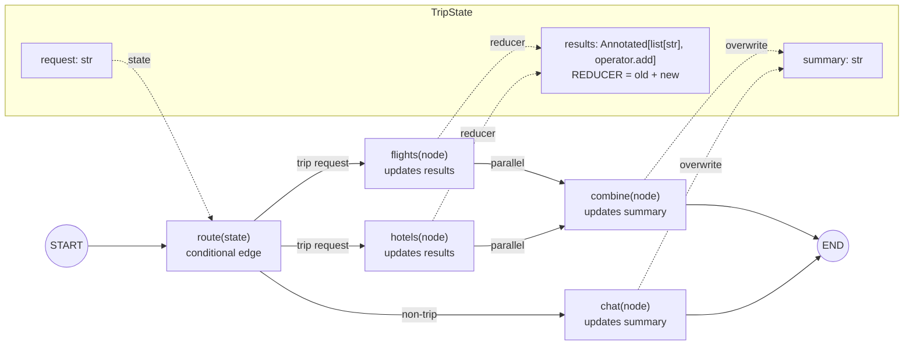
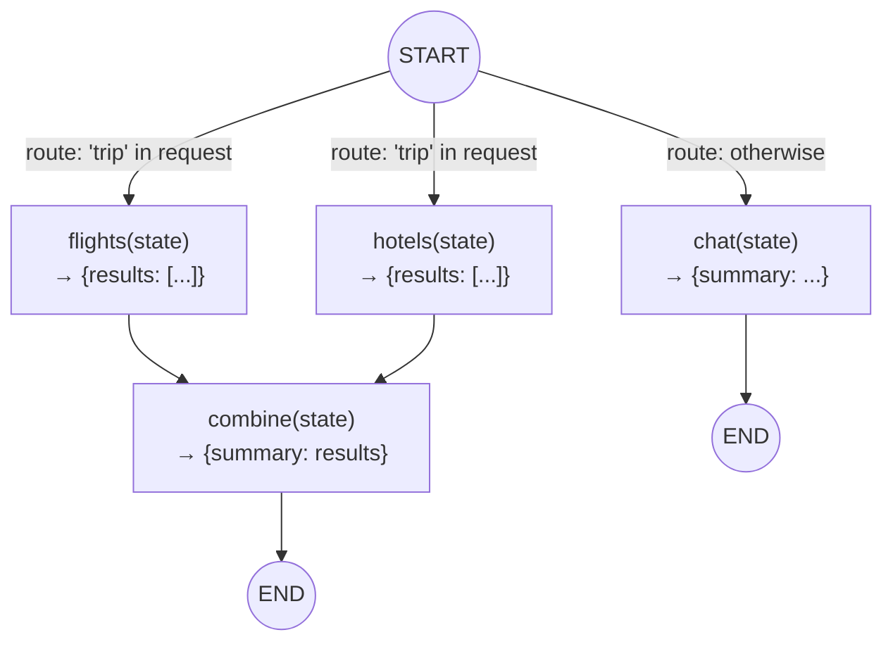

# Recap 1: graph basics, visualized

## Quick mental model



A picture of [recap_1_graph_basics.py](recap_1_graph_basics.py): state, nodes, edges and the reducer.

## 1. The state (shared by every node)

```
TripState (TypedDict)
┌──────────┬────────────────────────────────────┬──────────────────────────────────┐
│ key      │ type                               │ how writes are merged            │
├──────────┼────────────────────────────────────┼──────────────────────────────────┤
│ request  │ str                                │ overwrite (last write wins)      │
│ results  │ Annotated[list[str], operator.add] │ REDUCER: old + new (appended)    │
│ summary  │ str                                │ overwrite (last write wins)      │
└──────────┴────────────────────────────────────┴──────────────────────────────────┘
```

A key with no reducer accepts only **one** write per step. `results` gets two writes
in the same step (from `flights` and `hotels`), so it needs `operator.add`.

## 2. The graph

```
                         START
                           │
                     route(state)            ← conditional edge: returns WHERE to go,
                           │                   never changes state
          ┌────────────────┼──────────────────┐
  "trip" in request?       │                  │ otherwise
          │                │                  │
          ▼                ▼                  ▼
   ┌─────────────┐  ┌─────────────┐    ┌─────────────┐
   │  flights    │  │  hotels     │    │  chat       │
   │ (state)     │  │ (state)     │    │ (state)     │
   │ → results+= │  │ → results+= │    │ → summary=  │
   └──────┬──────┘  └──────┬──────┘    └──────┬──────┘
          │   run in parallel (same step)     │
          └────────┬───────┘                  │
                   │  join: waits for BOTH    │
                   ▼                          │
            ┌─────────────┐                   │
            │  combine    │                   │
            │ (state)     │                   │
            │ → summary=  │                   │
            └──────┬──────┘                   │
                   ▼                          ▼
                  END                        END
```

The same graph in Mermaid. GitHub renders this; in VS Code you need a Mermaid preview extension.



## 3. Edge types used

| Code | Kind | Meaning |
|---|---|---|
| `add_conditional_edges(START, route, [...])` | conditional | `route` picks the next node(s) at run time |
| `add_edge(["flights", "hotels"], "combine")` | join | `combine` runs only after **both** finish |
| `add_edge("combine", END)` | fixed | always go from `combine` to the end |

## 4. How the state changes, step by step

### `"plan a trip to Paris"`

```
step  ran                 node returned                        state after the step
────  ──────────────────  ───────────────────────────────────  ──────────────────────────────────────────
 0    (input)             —                                    request="plan a trip to Paris"
                                                               results=[]          summary=""
 1    flights ║ hotels    {results: ["flight: $450"]}          results = [] + ["flight: $450"]
      (parallel)          {results: ["hotel: $160/night"]}               + ["hotel: $160/night"]
                                                               ↑ the reducer merges both writes
 2    combine             {summary: state["results"]}          summary = ["flight: $450",
                                                                          "hotel: $160/night"]
 3    END
```

### `"hello"`

```
step  ran       node returned                     state after the step
────  ────────  ────────────────────────────────  ──────────────────────────────
 0    (input)   —                                 request="hello"  results=[]  summary=""
 1    chat      {summary: "Happy to help!"}       summary="Happy to help!"
 2    END
```

## 5. The rules in one place

- **Node** = `function(state) -> dict` with only the keys it changes. LangGraph merges that dict into the state.
- **Router** = `function(state) -> node name(s)`. Returning a list starts those nodes in parallel.
- **Reducer** = `Annotated[type, fn]`. It decides how several writes to one key are combined: `fn(old, new)`.
- **Without the reducer** on `results`, step 1 raises `InvalidUpdateError` ("Can receive only one value per step").
